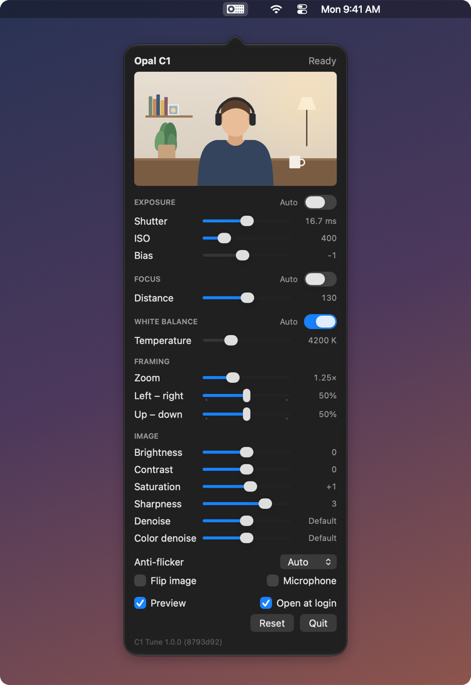

# C1 Tune

A small, fast menu bar app for the **Opal C1** webcam: real hardware controls, Opal's own
image tuning, and nothing else.

<p align="center">
  
</p>

- **Fast.** Plug-in to a 1080p30 webcam in about 5 seconds; reconnects to a running camera
  in under half a second. Idles at 0% CPU.
- **Real controls.** Exposure, focus, white balance, color, and zoom up to 2× without
  upscaling, all applied by the camera itself.
- **Lightweight.** One ~570 KB binary built with just the Xcode command line tools. No
  virtual camera, no AI features, no background services.
- **Safe.** Nothing is ever written to the camera's flash; unplugging it restores factory
  behaviour. If the app quits, the camera keeps working with your last settings.

Not affiliated with or endorsed by Opal Camera.

## Quick start

You need **Opal Composer 1.0.1 installed** (C1 Tune reads the camera's firmware and Opal's
tuning files from it), but **not running**: only one app can control the camera.

```bash
git clone https://github.com/ryankirkman/c1-tune.git && cd c1-tune
make install         # builds and copies C1 Tune to /Applications
make disable-opal    # stops Opal Composer's background services (see below)
open /Applications/C1Tune.app
```

Then tick **Open at login** in the panel. Settings are saved and re-applied whenever the
camera connects or an app starts using it.

## Controls

| | |
|---|---|
| Exposure | Auto with bias (−9…+9), or manual shutter (0.1–33 ms) and ISO (100–1600) |
| Focus | Continuous autofocus, or manual lens position |
| White balance | Auto, or manual 1000–12000 (the firmware's scale, see [Tuning](#tuning)) |
| Image | Brightness, contrast, saturation, sharpness, denoise, color denoise |
| Anti-flicker | Auto / 50 Hz / 60 Hz / off |
| Zoom | 1×–2× in 20 steps, never upscaled (see [Zoom](#zoom)) |
| Framing | Moves the zoomed picture left–right and up–down (snaps to center) |
| Flip image | Turns off the default 180° rotation, for a camera mounted upside down |
| Microphone | The camera's built-in mic, off by default (see [Microphone](#microphone)) |
| Preview | Optional live view in the panel |

Most changes apply instantly. Zoom, framing, flip, the microphone, and returning
sharpness/denoise to default restart the camera (about 5 seconds, once per burst of changes).

**Scripting:** every setting can be set from the command line:

```bash
/Applications/C1Tune.app/Contents/MacOS/C1Tune --set zoom=125 frameY=60 saturation=1
```

<details>
<summary>All <code>--set</code> keys</summary>

`autoExposure exposureUs iso exposureCompensation autoFocus lensPosition autoWhiteBalance
whiteBalanceK brightness contrast saturation sharpness noiseReduction colorNoiseReduction
antiFlicker zoom frameX frameY flipped microphone`

`default` clears sharpness or denoise back to the tuning's own value.
</details>

## Zoom

The sensor always runs in 4K. The camera scales that image down and cuts a 1920×1080
window from it, so every zoom level uses real sensor pixels:

> 1× · 1.07× · 1.08× · 1.10× · 1.17× · 1.20× · 1.25× · 1.30× · 1.33× · 1.40× · 1.47× ·
> 1.50× · 1.60× · 1.67× · 1.73× · 1.75× · 1.80× · 1.83× · 1.87× · 2×

These are all the steps the camera's scaler supports, each tested on the camera. Lower
zoom blends more sensor pixels into each output pixel, so 1–1.5× is the cleanest; 2× is
a plain 1:1 crop.

<details>
<summary>How the steps were found</summary>

The scaler takes a fraction n/d of the 4K image, so zoom = 2·n/d. The firmware only
accepts numerators up to 16: larger ones log "cannot meet HW constraints MAX_N" and
silently skip scaling. The scaled size must also stay even. Every fraction that fits was
booted on the camera, and all of them stream.

1× is the 4K image scaled by ½, not the sensor's native 1080p mode: on the same scene it
had about half the noise on a flat wall and slightly more fine detail.
</details>

## Tuning

Defaults were tuned on a live picture (a person at a desk, white wall behind, 3000 K
lighting) on top of Opal's IMX378 tuning:

| Setting | Default | Why |
|---|---|---|
| Exposure bias | −1 | At 0 the face washes out and a white wall nears clipping; −2 is too dark |
| Saturation | +1 | Slightly livelier skin without going orange |
| Sharpness | 3 | Crisper than the tuning's own (≈2) with no visible halos |
| White balance | Auto | Neutral, and keeps up if daylight changes the room |
| Contrast, brightness, denoise | Tuning's | Contrast is already strong; denoise 4 erases detail |
| Manual shutter | 16.7 ms | 1/60 s avoids banding under 60 Hz lighting (only used with auto exposure off) |

**The white-balance scale isn't true color temperature.** Under 3000 K light, "2800" is
strongly blue and neutral sits around "3800–4000". Around "4200" gives a warm look.

## Microphone

**Off by default.** The camera still appears as "Opal C1 Audio Mic" in macOS and call
apps, but it records silence. **On**, it's a normal USB mic, set up the way Opal Composer
does it: the two front mics at a fixed 30 dB gain.

<details>
<summary>Why it can't be hidden, and how loud it is</summary>

The firmware always advertises the USB microphone. Hiding it would mean changing the
firmware's USB descriptors, and both ways tried (cutting the audio interfaces out, or
marking them vendor-specific) stop the camera's link from coming up; it then resets within
seconds.

Measured against a MacBook's built-in mic over the same seconds, the Opal mic reads about
8–12 dB louder under C1 Tune (about 4 dB louder in the camera's standalone mode). Peaks
reached about −1.5 dBFS in testing.
</details>

## Keeping Opal Composer out of the way

If Opal Composer has ever been set up on a Mac, its login item and helpers can start it
again (for example when the camera is plugged in) and take the camera. Switch them off:

```bash
make disable-opal    # asks for your password for Opal's root helpers
make enable-opal     # undo
```

This quits Opal Composer and disables its launchd jobs: login items, the
start-on-USB-plug agent, the virtual-camera assistant, and the camera-extension, update
and uninstall helpers. Nothing is deleted, and `scripts/disable-opal.sh --dry-run` shows
what it would do. Opal's virtual-camera system extension stays installed but idle; only
Opal Composer can remove it. If Opal Composer does hold the camera, C1 Tune's panel says so.

## Limitations

- **The microphone can't be hidden** (see [Microphone](#microphone)), and its gain is fixed.
- **No live readout of auto values** (the exposure, ISO, focus and white balance the camera picks).
- **Zoom restarts the camera.** Zoom is part of the pipeline the camera starts with. Opal
  changes it live with an extra resize step, which upscales and softens the picture.
- **Tested on one camera**: an IMX378 Opal C1, on macOS 27 on Apple silicon, with Opal
  Composer 1.0.1. The IMX582 revision's tuning is picked automatically but untested.

## Hardware

| | |
|---|---|
| Camera | Opal C1 (USB-C webcam by Opal Camera) |
| Processor | Intel Movidius Myriad X, running Luxonis DepthAI firmware |
| Image sensor | Sony IMX378, 12 MP (as reported by the firmware), mounted upside down |
| Focus | Autofocus lens on a voice-coil motor (lens position 0–255) |
| Status light | RGB LED on GPIOs 34 (blue), 37 (green), 58 (red); white while streaming |
| Microphone | USB audio, "Opal C1 Audio Mic": 2 channels (front pair), 48 kHz |
| USB | `03e7:f63b` running, `03e7:f63c` bootloader, `03e7:2485` USB boot ROM; 5 Gbps |
| Video out | UVC, NV12 1920×1080 at 30 fps |

## How it works

Out of the box the Opal C1 runs a standalone app from flash: a plain webcam that accepts
standard webcam control requests but ignores them. Opal Composer gets real control by
booting the camera into DepthAI firmware over USB; C1 Tune does the same with a minimal
pipeline.

1. **Reboot to the bootloader**: USB vendor request `0xF5`/`0x0DA1`.
2. **Drop to the USB boot ROM**: one XLink command, `USB_ROM_BOOT`.
3. **Upload firmware to RAM**: a boot header carrying the board config (UVC on), then the
   firmware with its webcam formats patched to advertise only 1920×1080.
4. **Start a pipeline over RPC**: camera (with Opal's tuning file) → UVC webcam output, an
   XLinkIn `control` input, and with the microphone on, `AudioMic` → USB audio (`UAC`).
5. **Control**: every setting is a DepthAI `CameraControl` message written to `control`.
   The camera ignores them while no app is streaming, so they're re-sent when one starts.

<details>
<summary>What live testing established (and the code relies on)</summary>

- **Watchdog**: booting with `watchdogTimeoutMs = 0` makes the firmware reset the moment video
  starts. The firmware default is used, and the app feeds the watchdog from its own thread.
- **Frame size**: the firmware only streams when the frame *index* a client requests maps to
  the pipeline's output size, so the 4K/1440p/720p descriptors are rewritten to the 1080p
  entry. Every app gets 1080p; macOS scales it for apps that want less.
- **Sensor modes**: native 1080p works, and so does 4K with any ISP scale whose numerator is
  ≤ 16, down to ½. An earlier "RGB postprocessing error" at ½ was the frame-index mismatch
  above, not the scaler.
- **The bootloader serves one session**: talk to it once, cleanly, then boot.
- **Fast restart**: the same `0xF5` request works on the running firmware, so restarting the
  pipeline takes ~5 s instead of waiting for the standalone app to boot.
- **Audio**: the USB mic only carries sound when an `AudioMic` node feeds a `UAC` node. Both
  exist only in Opal's fork of depthai-shared (`12dc4c5`); their IO names and queue sizes
  come from the node constructors in Opal's `libdepthai-core`. The firmware turns the mic on
  only while an app is recording ("UAC restart" in its log).
- **Reattach keeps the running pipeline**: when C1 Tune starts and the camera is already
  running a pipeline (e.g. after the app relaunches), it's reused as is, microphone setting
  included. A camera left running by an older C1 Tune keeps that version's audio setup until
  it restarts (any setting that restarts the camera, or a replug).
</details>

<details>
<summary>Sources and tests</summary>

Protocol details come from Luxonis's open-source depthai-core, XLink and depthai-shared at
the versions matching Opal's firmware (device side `26f3d765`, depthai-shared `12dc4c5`).
The pipeline settings Opal uses (board socket, planar output, GPIOs, orientation, chunk
size, microphone setup) were read from its binary. `Tests/fixtures` holds reference
messages generated by compiling those headers, and `make test` checks the encoders against
them byte for byte. Nothing from Opal is redistributed here.

| File | |
|---|---|
| `Sources/USB.swift` | IOKit access to each boot stage |
| `Sources/XLink.swift` | XLink link protocol (84-byte headers, streams, watchdog keepalive) |
| `Sources/DepthAI.swift` | libnop/msgpack encoders, boot image + descriptor patch, pipeline schema, RPC, firmware extraction |
| `Sources/OpalSession.swift` | Boot/attach state machine and control delivery |
| `Sources/CameraSettings.swift` | Saved settings → camera commands, zoom/framing |
| `Sources/StreamWatcher.swift` | Notices when an app starts the webcam (CoreMediaIO) |
| `Sources/StatusIcon.swift` | Menu bar icon (the C1 drawn from the front) |
| `scripts/disable-opal.sh` | Switches Opal Composer's background services off and on |
</details>

## Make targets

| | |
|---|---|
| `make install` | Build and copy to /Applications |
| `make reinstall` | Rebuild, swap the installed app and relaunch it |
| `make test` | Offline protocol tests (no camera needed) |
| `make disable-opal` / `make enable-opal` | Switch Opal Composer's background services off / on |
| `make uninstall` | Remove the app, its login item and its settings |

The screenshot above is the real panel, launched with `C1TUNE_DEMO_IMAGE=<picture>` so the
preview shows an illustration instead of the camera.
